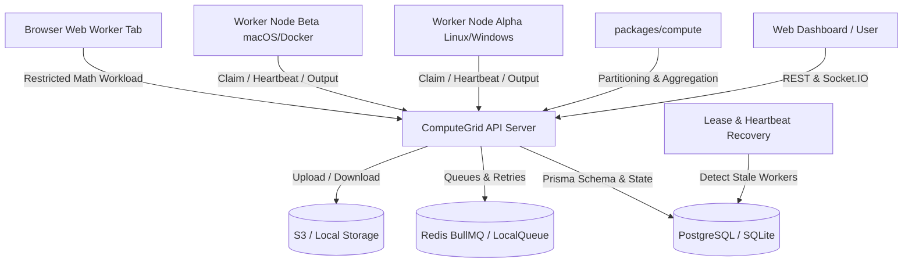

# ComputeGrid: Cloud-Coordinated Decentralized Compute Grid

ComputeGrid is a production-grade distributed compute platform that partitions intensive computational workloads into discrete tasks, distributes them across heterogeneous connected worker machines (Linux, Windows, macOS, or in-browser tabs), enforces authenticated leases with automatic recovery, and aggregates/validates deterministic results with cryptographic proofs.

---

## 1. Project Organization

```
compute-grid/
├── apps/
│   ├── web/                  # React dashboard, pages, components, API client, charts
│   ├── api/                  # Express API, authentication, scheduling, WebSockets
│   └── worker/               # Worker agent, heartbeats, execution, result reporting
├── packages/
│   ├── shared/               # Shared types, schemas, status definitions
│   └── compute/              # Task partitioning, supported workloads, aggregation
├── prisma/                   # Database schema, migrations, seed data
├── infra/                    # Docker Compose, deployment and service configuration
└── README.md and .env.example
```

---

## 2. System Architecture



---

## 3. Supported Workloads

### Workload A: Parallel Mathematical Computation (`MATH_PARALLEL`)
- **Algorithms**:
  - `prime-count`: Evaluates prime count, sum of primes, and highest prime within range $[a, b]$ split into $N$ contiguous sub-intervals.
  - `numerical-integration`: High-order Riemann/trapezoidal summation of polynomial, sinusoidal, or Gaussian integrals.
- **Reference Validation**: Each aggregated result is automatically compared against single-process reference calculations (`referencePrimeCompute` / `referenceIntegrationCompute`).

### Workload B: File Chunk Processing (`FILE_CHUNK_PROCESSING`)
- **Operations**:
  - `word-count`: Distributed map-reduce word frequency aggregation.
  - `regex-filter`: Parallel regular expression pattern extraction.
  - `line-stats`: Distributed line, word, character, and whitespace aggregation.
- **Integrity**: Every chunk contains an independent SHA-256 cryptographic checksum.

---

## 4. Quick Start & Local Development

### Prerequisites
- Node.js v18+ (tested on Node v20/v24)
- npm v9+

### 1. Install & Build
```bash
npm install
npm run build
```

### 2. Initialize Database & Seed Accounts
```bash
npm run prisma:generate
npm run prisma:migrate
npm run prisma:seed
```
*Seeded accounts:*
- **Admin**: `admin@computegrid.io` / `AdminGrid123!`
- **User**: `demo@computegrid.io` / `DemoGrid123!`
- **Enrollment Token**: `cg_enroll_demo_initial_token_12345`

### 3. Start API & Frontend Concurrently
```bash
npm run dev
```
- Frontend Dashboard: `http://localhost:5173`
- Backend API Server: `http://localhost:4000`
- Swagger Interactive Docs: `http://localhost:4000/api/docs`

---

## 5. Connecting Worker Nodes

### Via In-Browser Worker
1. Open the dashboard at `http://localhost:5173`.
2. Click the **Browser Node** button in the top navigation bar.
3. Click **Start In-Browser Worker** to execute math chunks directly in your browser tab.

### Via Native CLI (Windows, macOS, Linux)
1. On your dashboard, navigate to **Enroll Workers** (`/workers/onboarding`).
2. Generate an enrollment token or use the seeded token:
```bash
npx @computegrid/worker start --server http://localhost:4000 --token <ENROLLMENT_TOKEN>
```
3. The worker will automatically register hardware capabilities (cores, RAM, OS), establish periodic heartbeats, and begin processing assigned chunks.

---

## 6. Automated Testing

### Unit & Integration Tests (27 Tests)
```bash
npm test
```
Runs automated unit and integration tests across `packages/compute`, `apps/api`, and `apps/worker` verifying partitioning, aggregation, mathematical equivalence, lease renewals, worker auth, and storage security.

### Multi-Worker End-to-End Test
```bash
npm run test:e2e
```
Spins up two worker nodes simultaneously, submits a 4-chunk compute job, verifies distributed execution across both nodes, checks reference equivalence, downloads output artifacts, and tests unauthorized access rejection.

---

## 7. Production Docker Deployment

```bash
docker compose -f infra/docker-compose.yml up --build -d
```
Starts:
- PostgreSQL 16 on port 5432
- Redis 7 on port 6379
- MinIO Object Storage on ports 9000 & 9001
- API Server on port 4000
- Frontend Dashboard on port 5173
- 2x Independent Worker Node Containers (`Container-Worker-Alpha` and `Container-Worker-Beta`)
