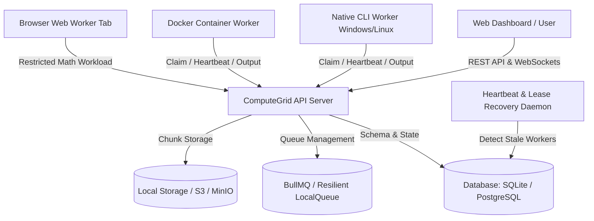

# ComputeGrid: User Manual & Modern Architectural Guide

---

## Part 1: What is the Use of this in the Modern Era?

### 1. The Modern Compute Dilemma
In today's cloud landscape, computing costs are skyrocketing:
- **Cloud Rent & Egress Tax**: Running parallel batch tasks 24/7 on AWS EC2, GCP, or Azure can cost thousands of dollars per month in instance fees and network egress.
- **Vast Idle Compute Power**: In almost every company, lab, or university, hundreds of powerful machines (MacBooks, Windows PCs, Linux workstations) sit idle with 80%+ unused CPU/GPU capacity.
- **Privacy & Air-Gapped Workloads**: Regulated industries (finance, healthcare, defense, confidential research) cannot easily send raw proprietary files or calculations to public clouds.

### 2. What ComputeGrid Does
**ComputeGrid** turns any fleet of disparate computers into an elastic, fault-tolerant supercomputing cluster:
- **Zero-Install Compute Nodes**: Anyone on your team can contribute compute power simply by keeping an in-browser tab open (**Browser Worker**).
- **Heterogeneous Workers**: Connect physical Linux/macOS/Windows workstations, cloud VMs, Docker containers, or browser tabs into a single unified queue.
- **Deterministic Reliability**: Chunks are cryptographically validated with SHA-256 proofs and cross-referenced with single-process baselines.
- **Self-Healing Fault Tolerance**: If a worker laptop goes to sleep or disconnects, the lease recovery daemon re-queues and re-assigns the uncompleted tasks in real time without failing the job.

### 3. Real-World Applications
1. **Financial Risk & Monte Carlo Analysis**: Simulating millions of price fluctuations or portfolio stress tests across company machines overnight.
2. **Scientific & Cryptographic Math**: High-range prime factorizations, numerical integration, and grid parameter tuning.
3. **Log & Big Data Processing**: Distributed map-reduce (regex filtering, frequency analysis, line statistics) across large datasets without expensive Hadoop/Spark overhead.
4. **Crowdsourced & Volunteer Computing**: Distribute open research jobs (like Folding@home or SETI) to global participants via the web.

---

## Part 2: System Architecture



---

## Part 3: Step-by-Step User Manual

### 1. Access the Platform
Your local environment is running at:
- **Frontend Dashboard**: [http://localhost:5173](http://localhost:5173)
- **Interactive Swagger Docs**: [http://localhost:4000/api/docs](http://localhost:4000/api/docs)
- **API Base URL**: `http://localhost:4000/api/v1`

#### Default Login Accounts:
| Role | Email | Password |
| :--- | :--- | :--- |
| **Administrator** | `admin@computegrid.io` | `AdminGrid123!` |
| **Demo User** | `demo@computegrid.io` | `DemoGrid123!` |

---

### 2. Connect Compute Workers

Choose one of three ways to attach computing power:

#### Option A: In-Browser Worker (Instant / Zero Install)
1. Open the dashboard at [http://localhost:5173](http://localhost:5173).
2. Click the **Browser Node** button in the top navigation bar.
3. Click **Start In-Browser Worker**.
4. That browser tab will now claim parallel math chunks via WebSockets, execute them locally, and submit verified results back to the server.

#### Option B: Native CLI Worker (Physical Machine)
Run this in any terminal on your local machine or external computer:
```bash
npx @computegrid/worker start --server http://localhost:4000 --token cg_enroll_demo_initial_token_12345
```
The worker automatically detects your CPU cores, RAM, and OS, and listens for assigned chunks.

#### Option C: Production Docker Cluster
Start PostgreSQL, Redis, MinIO, API, Web, and two dedicated worker containers:
```bash
docker compose -f infra/docker-compose.yml up --build -d
```

---

### 3. Submit and Run a Compute Job

1. On the left sidebar, click **Submit Job** (`/jobs/new`).
2. Select your job type:
   - **Parallel Mathematical Computation**: Compute prime counts or numerical integrals across parallel intervals (e.g., from `1` to `5,000,000` divided into `8` chunks).
   - **Distributed File Processing**: Upload a text/log file and perform distributed `word-count`, `regex-filter`, or `line-stats`.
3. Click **Launch Distributed Job**.

---

### 4. Monitor Execution & Download Results

- **Live Progress**: Visit `/jobs/:id` to watch tasks being claimed in real-time across connected workers.
- **Task Explorer**: Inspect execution durations, worker IDs, and SHA-256 output hashes.
- **Artifacts**: Download the final merged output file once all chunks are aggregated and verified.
- **Worker Health**: Go to `/workers` to monitor system loads, active leases, and heartbeat statuses.

---

## Part 4: API Quick Reference

Submit jobs programmatically via curl or your own applications:

```bash
# 1. Login
curl -X POST http://localhost:4000/api/v1/auth/login \
  -H "Content-Type: application/json" \
  -d '{"email":"demo@computegrid.io","password":"DemoGrid123!"}'

# 2. Submit Math Job
curl -X POST http://localhost:4000/api/v1/jobs \
  -H "Authorization: Bearer <YOUR_TOKEN>" \
  -H "Content-Type: application/json" \
  -d '{
    "name": "Distributed Prime Test",
    "type": "MATH_PARALLEL",
    "algorithm": "prime-count",
    "params": { "start": 1, "end": 1000000, "chunks": 4 }
  }'
```
